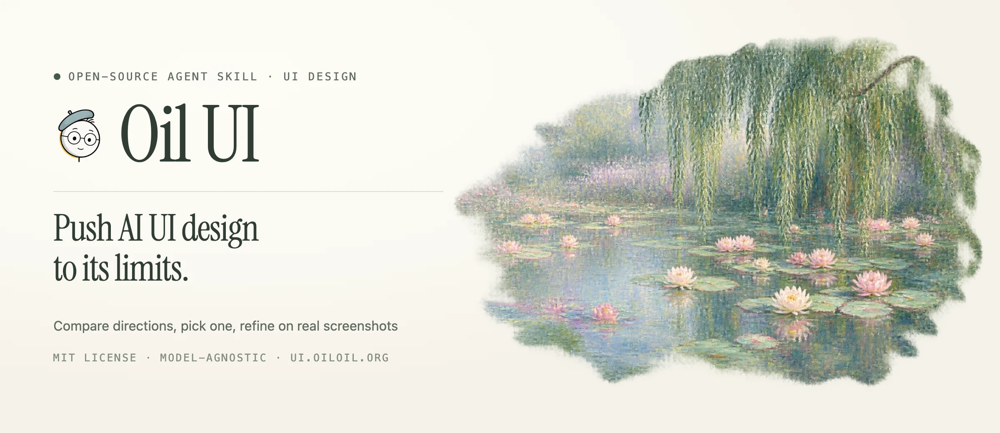
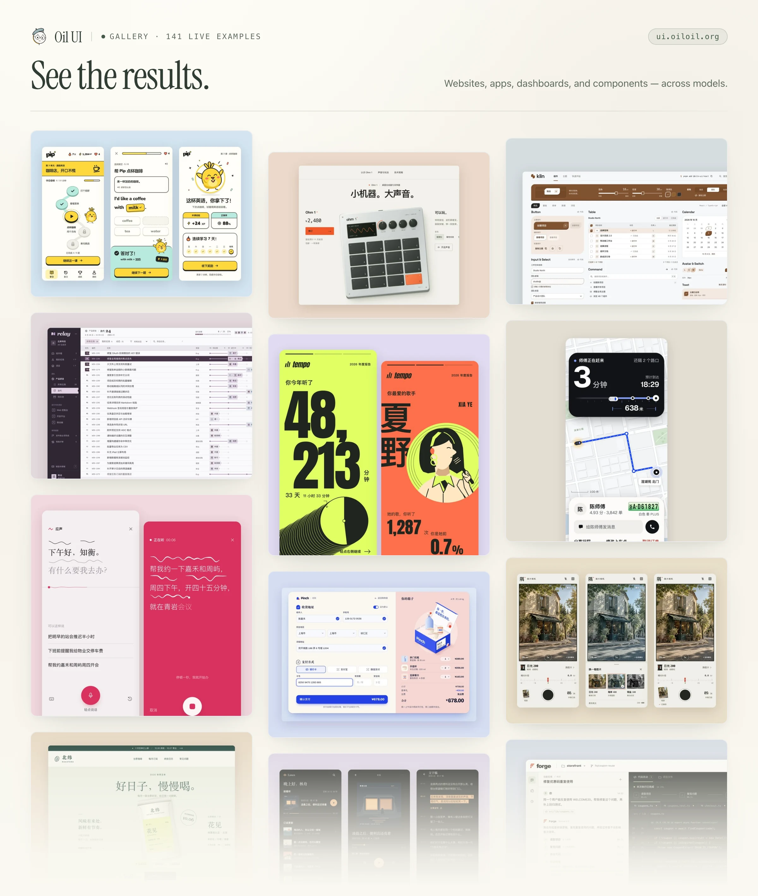
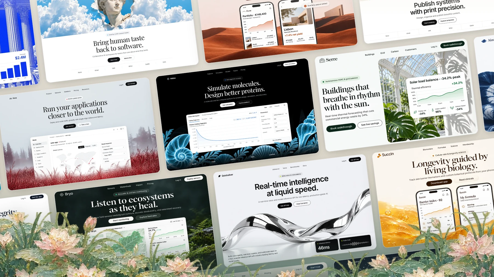

[English](README.md) · [中文](README.zh-CN.md) · 日本語 · [한국어](https://ui.oiloil.org/ko/?utm_source=github&utm_medium=referral&utm_campaign=readme-ja&utm_content=lang-bar) · [Deutsch](https://ui.oiloil.org/de/?utm_source=github&utm_medium=referral&utm_campaign=readme-ja&utm_content=lang-bar) · [Español](https://ui.oiloil.org/es/?utm_source=github&utm_medium=referral&utm_campaign=readme-ja&utm_content=lang-bar)

[](https://github.com/oil-oil/oil-ui/stargazers) [](https://www.skills.sh/oil-oil/oil-ui/oil-ui) [](https://ui.oiloil.org/ja/?utm_source=github&utm_medium=referral&utm_campaign=readme-ja&utm_content=hero-gallery) [-5b533b?style=flat-square)](https://ui.oiloil.org/ja/guide/ui-design-skills-tested/?utm_source=github&utm_medium=referral&utm_campaign=readme-ja&utm_content=guide-benchmark) [](LICENSE)

**Oil UI** は、AI コーディングエージェント向けのインターフェース／UI・UX デザインスキルです。1 つの明確な方向性を推奨して実際のブラウザスクリーンショットをもとに磨き上げるか、比較を求められた場合は 3 つの異なる方向性を並べて検討します。143 件のライブ事例は [ui.oiloil.org](https://ui.oiloil.org/ja/?utm_source=github&utm_medium=referral&utm_campaign=readme-ja&utm_content=intro-text) でご覧いただけます。

```bash
npx skills add oil-oil/oil-ui
```

**対応エージェント：** Claude Code, Cursor, Codex, Windsurf, Cline, Antigravity, OpenCode, GitHub Copilot, Roo Code, DeepSeek Harness（[dsh-oil-ui](https://github.com/oil-oil/dsh-oil-ui)）, Kimi Code, Trae ほか `SKILL.md` 対応エージェント。

<p align="center">
  
</p>

<p align="center">
  <a href="https://ui.oiloil.org/ja/?utm_source=github&utm_medium=referral&utm_campaign=readme-ja&utm_content=showcase-banner"></a>
</p>

### アートディレクション型ランディングページ（Oil UI Pro に無料同梱 `oil-art-landing`）

通常のプロダクト UI や管理画面に加え、**Oil UI Pro** には専用コンパニオンスキル **`oil-art-landing`** が無料同梱されます。**デスクトップ＆モバイルアプリ向けの多彩なビジュアルアンカー**（赤外線フィルム、極地氷河、X 線暗室、温室モンステラ、苔とスレート、長虹ガラス、活版空押し、テラコッタ砂丘、光学氷塊、藍染絞りなど）とプロダクトに合わせた派生ルールを備え、3 方向の比較から前景レイヤー付きのリアルな Web ページ実装まで一貫対応します。[20 件のライブ事例を見る →](https://ui.oiloil.org/ja/art-landing/?utm_source=github&utm_medium=referral&utm_campaign=readme-ja&utm_content=art-landing-banner)

<p align="center">
  <a href="https://ui.oiloil.org/ja/art-landing/?utm_source=github&utm_medium=referral&utm_campaign=readme-ja&utm_content=art-landing-banner"></a>
</p>

## インストール

ターミナルで実行します：

```bash
npx skills add oil-oil/oil-ui
```

または、スキルを導入できるエージェントに次を送ってください：

```text
次のコマンドを実行してこのスキルをインストールしてください：npx skills add oil-oil/oil-ui
```

インストール後すぐに使え、設定は不要です。新しいバージョンが出ると返答の最後で知らせてくれます。すでに Oil UI Pro をお持ちの場合はオープンソース版は不要です（両方入れると同じ依頼を奪い合います）。

DeepSeek Harness をお使いの場合はネイティブプラグイン [dsh-oil-ui](https://github.com/oil-oil/dsh-oil-ui)（`dsh plugin --profile web add github:oil-oil/dsh-oil-ui`）をご利用ください。

## 使い方

必要なことをエージェントに伝えてください。たとえば：

- 「oil-ui を使って、このコース予約のプロダクトのデザインの方向性をいくつか探り、プレビューできるページを作って。」
- 「タイポグラフィ、色、構図が異なる 3 つのデザインを作って。選べるように比較ページにまとめて。」
- 「プロジェクトの既存のデザインガイドラインに沿って、このページを磨き上げて。」
- 「このホームページをレビューして、何をどう変えるべきか説明して。ファイルには手を加えないで。」
- 「スクリーンショットからこのページを再現して、モバイルのレイアウトも追加して。」

ブランドのアセット、スクリーンショット、既存のプロジェクトがあれば共有してください。中間の候補、スクリーンショット、メディアのキャッシュは `.oil-ui` ワークスペースに保存され、本番コードとアセットはプロジェクトに書き戻されます。

## デザインの進め方

1. **プロダクトが何なのかを理解する。** 何かを描く前に、プロダクトのカテゴリを特定し、最も個性的なスタイルを持つ同種のプロダクトを 2〜3 個見つけて、何を残し何を変えるかを決めます。
2. **「上質」や「すっきり」を、実際の判断に落とし込む。** 主題、オーディエンス、ブランドの語り口からトーンを定め、書体・余白・色の配分という目に見える選択に変えます。
3. **それぞれの方向性を、具体的なものから始める。** その場にある素材、場面、あるいは別分野の視覚言語から発想し、「ミニマル」のような抽象語からは始めません。
4. **最初の画面を誰のためのものにするかを決める。** 閲覧・買い物・実務のページでは最初の画面をコンテンツと操作そのものにします。説得のためのページだけ、コピーを書く前にオープニングの構図を決めます。
5. **明示的な比較では、本当に違うものにする。** レイアウト、タイポグラフィ、色、主要なイメージのうち共通にしてよいのは最大 1 つだけです。明暗のシルエットが似ていればレイアウトから変えます。
6. **人の記憶に残る瞬間を 1 つ残す。** ページ全体を飾るのではなく、タップへの反応や支払い完了など 1〜2 か所の細部だけを特別にし、それ以外は静かに保ちます。
7. **何がよいかを決めるのはあなたです。** デフォルトでは 1 つの方向性を推奨し、比較を求められたときは 1 つの比較ページに並べてフィードバックを反映します。
8. **実際の画面を信頼する。** デスクトップとモバイルの実画面スクリーンショットを確認し、作業過程を見ていない独立レビュアーのチェックと引き算のラウンドで仕上げます。

既存プロジェクトのリデザイン、`DESIGN.md` の統合、必要に応じた 9/10 目標の反復ディープポリッシュ、19 種のカードプロトタイプについては [Oil UI Pro](https://ui.oiloil.org/ja/pro/?utm_source=github&utm_medium=referral&utm_campaign=readme-ja&utm_content=inline-pro) をご覧ください。違いは[下記](#オープンソース版と-pro)にまとめています。

## 組み込みのスタイル比較ページ

<p align="center">
  
</p>

デザインを比較したいときは、HTML ファイル、画像、開発サーバー上のページを 1 つの比較ページに並べます。デスクトップとモバイルの切り替え、実寸表示、矢印キーでの移動に対応し、「Select」でコピーした文をエージェントに貼るだけで続行できます。

## オープンソース版と Pro

<p align="center">
  
</p>

オープンソース版は、新しいページを白紙の状態から見栄えのよいデザインに仕上げます。Pro はその上に、使いやすさの徹底、既存プロジェクトの安全な改善、より厳格なレビューと磨き上げを追加します。

| | Oil UI（オープンソース版） | Oil UI Pro |
| --- | :---: | :---: |
| デザインの方向性：プロダクトのカテゴリ、トーン、明確に異なる方向性、比較ページ | ✓ | ✓ |
| ビジュアル：階層、タイポグラフィ、色、余白、イメージ、モーション | ✓ | ✓ |
| 記憶に残る瞬間とスクロールによるストーリーテリング（パララックス、連続ショット） | ✓ | ✓ |
| スクリーンショットからの再現 | ✓ | ✓ |
| ミニゲームのテンポ、手触り、生成アセット、リアルタイム 3D | ✓ | ✓ |
| 独立したレビュー | ビジュアルの採点と、軽量な UX のウォークスルー | デフォルトのブラインドレビュー＋選択式のディープポリッシュ（9/10 を目指す最大 3 回の再確認・同一経路 UX 再検証）、方向性の重複チェック、自律的なリスク調査 |
| 磨き上げ：AI デザインのありがちな初期設定のチェック、細部のチェックリスト、シンプルにする方法 | | ✓ |
| 使いやすさ：インタラクションと状態、フォーム、ダイアログとポップオーバー、デスクトップとモバイルのレイアウト | | ✓ |
| ダッシュボードとツール：プロダクトに合わせて選んだワークスペースのレイアウトと、全体を通した 1 つのスタイル | | ✓ |
| 既存のプロジェクト：UI の刷新、フローの修正、新機能の追加それぞれに別のアプローチ | どれが必要かを教えてくれます | ✓ |
| プロトタイプから本番コードへ：対応表を作り、プロジェクト自身のコンポーネントとライブラリで実装し、プロトタイプと並べて確認 | プロトタイプのコードを丸ごと貼り付けません | ✓ |
| デザインシステム：新しいプロジェクトでは DESIGN.md に記録し、矛盾するルールを 1 つに統合 | 矛盾を指摘します | ✓ |
| 1 ページから一式へ：ページマップ、ページの種類ごとの参照ページ、ページ間の一貫性のチェック、エージェント間での作業の分担 | | ✓ |
| 修正：「もっと上質な感じに」を具体的な変更に落とし込み、毎回のビフォー/アフター、確定した部分の維持、方向性そのものが間違っているときはそう伝える | | ✓ |
| 1 つのコンポーネントを極限まで磨き上げる | | ✓ |
| コードと空間的な展開のコンテナを備えた 19 のカードのプロトタイプ | | ✓ |
| 光の軌跡、ドットパターン、流れるグラデーションなどのエフェクト | | ✓ |
| ミニゲームのシーンのレイアウト、ビジュアル、状態のチェック | | ✓ |
| 無料同梱 `oil-art-landing`：デスクトップ＆モバイル向けの多彩なランディングページ表現＋プロダクト向け派生ルール、前景レイヤー付き実装に対応 | | ✓ |

Oil UI Pro は $19.99（買い切り・生涯アップデート、画像生成 100 クレジットと `oil-art-landing` 無料同梱）です。[ui.oiloil.org/pro](https://ui.oiloil.org/ja/pro/?utm_source=github&utm_medium=referral&utm_campaign=readme-ja&utm_content=comparison-table-pro) でご購入いただけます。

## バージョンの確認

使うたびに最大 10 分に 1 回、`ui.oiloil.org` の公開バージョン一覧を確認します（プロジェクトの内容は一切送信しません）。明示的に更新を頼まない限り、ファイルのダウンロードや置き換えは行いません。キャッシュ先は `~/.local/state/oil/`（Windows では `%LOCALAPPDATA%\oil\`）、無効化は `OIL_NO_UPDATE_CHECK=1` です。

## 組み合わせて使う

- [oil-motion](https://github.com/oil-oil/oil-motion)：生成した動画や連番フレームをスクロール・ドラッグ連動の Web アニメーションに変換します。
- [oil-tone](https://github.com/oil-oil/oil-tone)：見出しや説明文を自然で読みやすい文章に整えます。

## ライセンス

[MIT](LICENSE)
