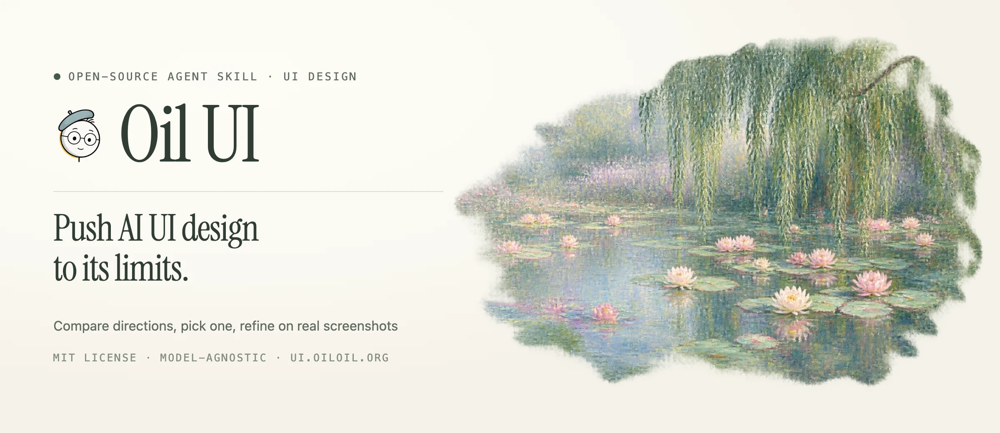
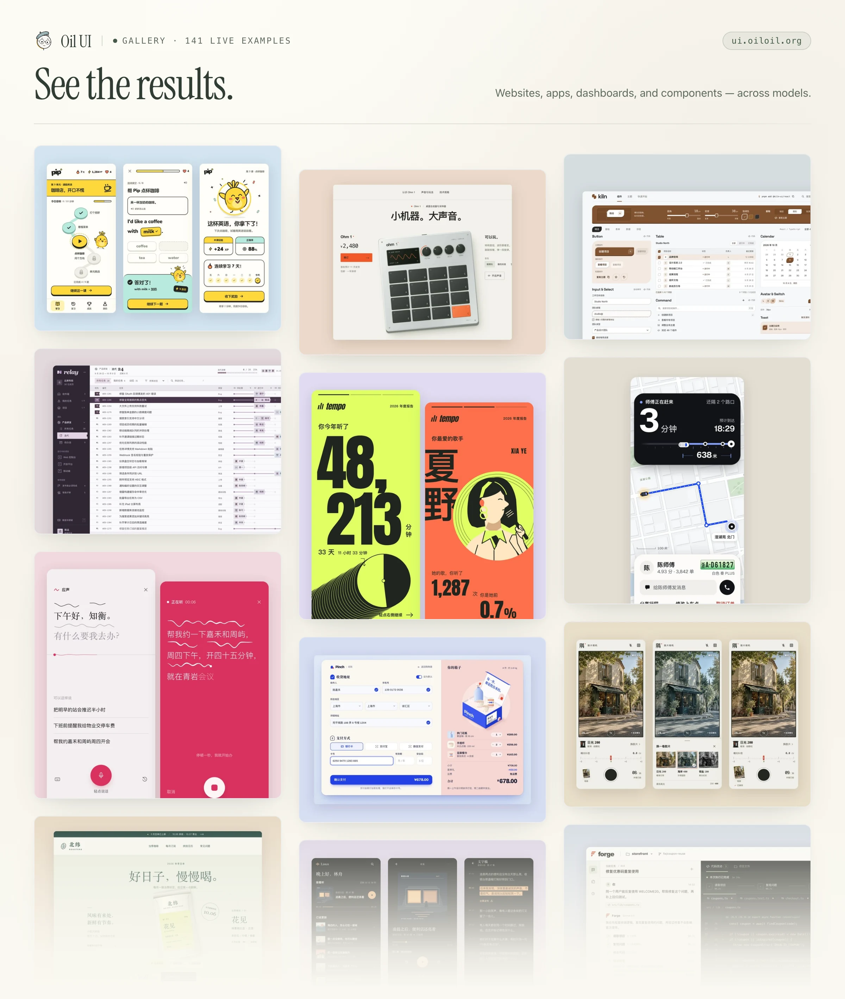
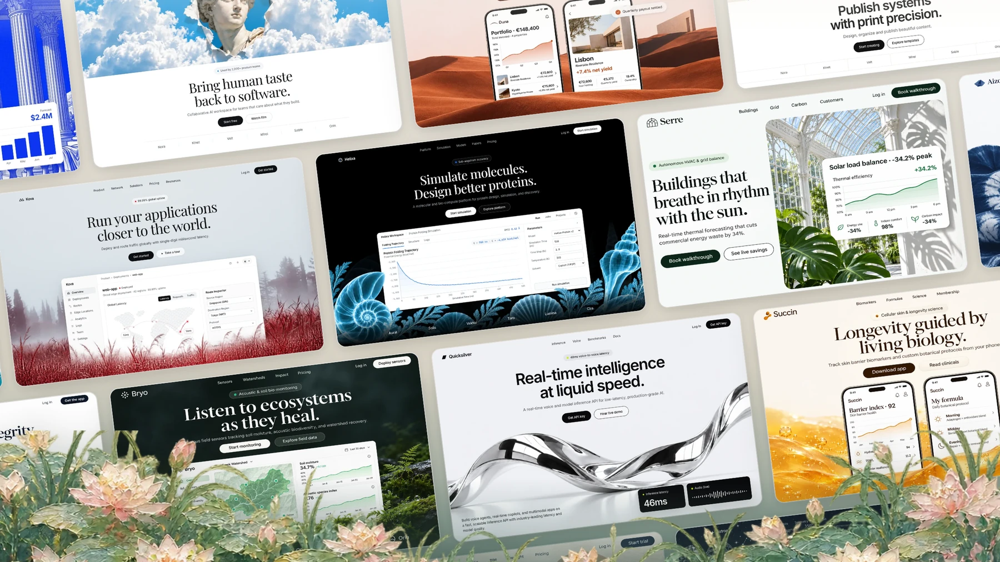

English · [中文](README.zh-CN.md) · [日本語](README.ja.md) · [한국어](https://ui.oiloil.org/ko/?utm_source=github&utm_medium=referral&utm_campaign=readme-en&utm_content=lang-bar) · [Deutsch](https://ui.oiloil.org/de/?utm_source=github&utm_medium=referral&utm_campaign=readme-en&utm_content=lang-bar) · [Español](https://ui.oiloil.org/es/?utm_source=github&utm_medium=referral&utm_campaign=readme-en&utm_content=lang-bar)

[](https://github.com/oil-oil/oil-ui/stargazers) [](https://www.skills.sh/oil-oil/oil-ui/oil-ui) [](https://ui.oiloil.org/en/?utm_source=github&utm_medium=referral&utm_campaign=readme-en&utm_content=hero-gallery) [-5b533b?style=flat-square)](https://ui.oiloil.org/en/guide/ui-design-skills-tested/?utm_source=github&utm_medium=referral&utm_campaign=readme-en&utm_content=guide-benchmark) [](LICENSE)

**Oil UI** is an interface & UI/UX design skill for AI coding agents. It recommends one clear visual direction and refines it against real-browser screenshots, or explores 3 genuinely distinct directions side by side when you ask to compare. Browse 141 live websites, apps, dashboards, and components at [ui.oiloil.org](https://ui.oiloil.org/en/?utm_source=github&utm_medium=referral&utm_campaign=readme-en&utm_content=intro-text).

```bash
npx skills add oil-oil/oil-ui
```

**Compatible with:** Claude Code, Cursor, Codex, Windsurf, Cline, Antigravity, OpenCode, GitHub Copilot, Roo Code, DeepSeek Harness ([dsh-oil-ui](https://github.com/oil-oil/dsh-oil-ui)), Kimi Code, Trae, and any `SKILL.md`-compatible agent.

<p align="center">
  
</p>

<p align="center">
  <a href="https://ui.oiloil.org/en/?utm_source=github&utm_medium=referral&utm_campaign=readme-en&utm_content=showcase-banner"></a>
</p>

### Art-Directed Landing Pages (Included Free with Oil UI Pro: `oil-art-landing`)

Beyond dashboards and product UI, **Oil UI Pro** includes the companion skill **`oil-art-landing`** at no extra cost: a **rich library of desktop & mobile app visual anchors** (infrared film, polar glacier, X-ray darkroom, sunlit conservatory, wet forest moss, fluted glass, cotton letterpress, terracotta dunes, optical ice, indigo shibori, and more) plus an open derivation grammar—compare 3 directions first, adapt or derive to fit your product, and ship live animated pages with real foreground occlusion. [Explore 20 interactive live examples →](https://ui.oiloil.org/en/art-landing/?utm_source=github&utm_medium=referral&utm_campaign=readme-en&utm_content=art-landing-banner)

<p align="center">
  <a href="https://ui.oiloil.org/en/art-landing/?utm_source=github&utm_medium=referral&utm_campaign=readme-en&utm_content=art-landing-banner"></a>
</p>

## Installation

Run in your terminal:

```bash
npx skills add oil-oil/oil-ui
```

Or send this sentence to an agent that can install skills:

```text
Install this skill for me: run npx skills add oil-oil/oil-ui
```

It works right after installation with zero configuration. When a newer version is available, your agent mentions it at the end of a reply; ask it to update whenever you want. If you already have Oil UI Pro installed, you don't need the open-source edition—installing both makes them compete for the same requests.

If you use DeepSeek Harness, install the native plugin [dsh-oil-ui](https://github.com/oil-oil/dsh-oil-ui) (`dsh plugin --profile web add github:oil-oil/dsh-oil-ui`; it bundles the free edition and automatically detects a local Oil UI Pro installation).

## Usage

Tell your agent what you want to build, review, or redesign:

- “Use oil-ui to explore a few design directions for this course booking product and build pages I can preview.”
- “Create three designs with different typography, colors, and compositions. Put them on a comparison page so I can choose.”
- “Polish this page using the project’s existing design guidelines.”
- “Review this homepage and explain what to change and how. Leave the files untouched.”
- “Recreate this page from the screenshot and add a mobile layout too.”

Share any brand assets, screenshots, or existing codebase you have. It can start without references and only asks questions when the deliverable itself is ambiguous. Intermediate candidates, screenshots, and media caches stay in `.oil-ui`; final code and production assets are written directly to your project.

## How it designs

1. **Understand what the product is.** Before drawing anything, it names the product category, finds two or three peers with distinctive styles, studies why their choices work, and decides what to keep or break away from.
2. **Turn “premium” and “clean” into real decisions.** It sets a concrete tone from the subject, audience, and brand voice—lively or calm, polished or raw, dense or airy—and turns it into visible choices for typefaces, whitespace, and color proportion.
3. **Start each direction from something concrete.** Ideas come from a material, a setting, an object, or the visual language of another craft—not vague adjectives like “minimal” or “bold.”
4. **Decide who the first screen is for.** On pages where people browse, shop, or get work done, screen one starts with the content and controls. Only pages meant to persuade get a choreographed opening layout, settled before copy is written.
5. **Make explicit comparisons truly different.** When you ask for 3 directions, layout, typography, color, and key imagery may share at most one trait between any two. It squints at light/dark shapes side by side and reworks the layout if two look alike.
6. **Leave one moment people remember.** Instead of decorating every block, it makes one or two interactions memorable—a tap response, a payment confirmation, AI in progress, or a 404 page—while keeping the rest quiet.
7. **You decide what looks right.** It recommends one direction for confirmation by default, or generates a single comparison page when asked so you can pick and steer before full implementation.
8. **Trust the real screen.** When a page is built, it opens desktop and mobile viewports to inspect real screenshots, dispatches an isolated reviewer without build-history bias, and finishes with a subtraction pass.

For existing-codebase UI renovations, `DESIGN.md` consolidation, optional multi-round 9/10 deep polish, or 19 coded card prototypes, see [Oil UI Pro](https://ui.oiloil.org/en/pro/?utm_source=github&utm_medium=referral&utm_campaign=readme-en&utm_content=inline-pro). Full differences are listed [below](#open-source-and-pro).

## Benchmarks & Playbooks

- **[4 UI Design Skills Tested (15 Blind Runs & Live Demos)](https://ui.oiloil.org/en/guide/ui-design-skills-tested/?utm_source=github&utm_medium=referral&utm_campaign=readme-en&utm_content=guide-benchmark)**: Same model, same task brief, 15 independent generations across Oil UI, `frontend-design`, `UI UX Pro Max`, `Impeccable`, and a no-Skill control, with desktop/mobile screenshots and live HTML demos.
- **[Refreshing Existing Project UI Without Breaking Logic](https://ui.oiloil.org/en/guide/existing-project-ui-renovation/?utm_source=github&utm_medium=referral&utm_campaign=readme-en&utm_content=guide-renovation)**: How to diagnose live screens, renovate across three controlled steps (tidy noise, upgrade layout, rework flow), cut clicks, and extract a repo-wide `DESIGN.md`.
- **[Fixing Generic "AI Slop" UI](https://ui.oiloil.org/en/guide/fix-ai-ui-slop/?utm_source=github&utm_medium=referral&utm_campaign=readme-en&utm_content=guide-antislop)**: A subtraction checklist for stripping out glowing eyebrow pills, 4px left accent bars, triple-nested cards, and invented KPI metrics.
- **Agent & Scenario Guides**: [Claude Code UI Design](https://ui.oiloil.org/en/guide/claude-code-ui-design/?utm_source=github&utm_medium=referral&utm_campaign=readme-en&utm_content=guide-claude) · [OpenAI Codex UI Design](https://ui.oiloil.org/en/guide/codex-ui-design/?utm_source=github&utm_medium=referral&utm_campaign=readme-en&utm_content=guide-codex) · [SaaS Landing Pages](https://ui.oiloil.org/en/guide/landing-page-design/?utm_source=github&utm_medium=referral&utm_campaign=readme-en&utm_content=guide-landing) · [Dashboards & Workspaces](https://ui.oiloil.org/en/guide/dashboard-workspace-design/?utm_source=github&utm_medium=referral&utm_campaign=readme-en&utm_content=guide-dashboard) · [Interactive Walkthrough](https://ui.oiloil.org/en/intro/?utm_source=github&utm_medium=referral&utm_campaign=readme-en&utm_content=intro)

## Built-in style comparison page

<p align="center">
  
</p>

When you want to compare designs, it puts them side by side on one page. Candidates can be HTML files, images, or running local dev servers, with the current version placed first as a baseline. Switch between desktop and mobile viewports, open each candidate at actual size, browse with arrow keys, click “Select” on your favorite, and paste the copied prompt back into your agent.

<a id="oil-ui-vs-oil-ui-pro"></a>

## Open source and Pro

<p align="center">
  
</p>

The open-source version takes a new page from a blank start to a distinctive design. Pro builds on that: it makes interfaces easier to use, renovates existing projects without breaking logic, and raises the bar with deeper review and polishing.

| | Oil UI (open source) | Oil UI Pro |
| --- | :---: | :---: |
| Design direction: product category, tone, distinct directions, comparison page | ✓ | ✓ |
| Visuals: hierarchy, typography, color, spacing, imagery, and motion | ✓ | ✓ |
| Memorable moments and scroll storytelling (parallax, continuous shots) | ✓ | ✓ |
| Screenshot recreation | ✓ | ✓ |
| Pacing, feel, generated assets, and real-time 3D for mini-games | ✓ | ✓ |
| Independent review | Visual scoring and a lightweight UX walkthrough | Default blind review + optional deep polish (up to 3 rounds aiming for 9/10 & same-path UX rechecks); direction-overlap checks and autonomous UX risk probes |
| Polish: checks for AI design defaults, a detail checklist, and how to simplify | | ✓ |
| Usability: interactions and states, forms, dialogs and popovers, desktop and mobile layouts | | ✓ |
| Dashboards and tools: workspace layouts chosen for the product, with one style throughout | | ✓ |
| Existing projects: separate approaches for a UI refresh, a flow fix, and a new feature | Tells you which one you need | ✓ |
| Prototype to production code: a mapping table, built with the project's own components and libraries, checked side by side against the prototype | Doesn't paste the prototype's code wholesale | ✓ |
| Design system: record DESIGN.md for new projects, merge conflicting rules into one | Points out the conflicts | ✓ |
| From one page to a full set: page map, a reference page per page type, cross-page consistency checks, splitting work across agents | | ✓ |
| Revisions: turn "make it feel more premium" into concrete changes, before/after for every round, keep confirmed parts intact, say when the direction itself is wrong | | ✓ |
| Polish a single component to the extreme | | ✓ |
| 19 card prototypes with code and spatial expansion containers | | ✓ |
| Effects such as light trails, dot patterns, and flowing gradients | | ✓ |
| Scene layouts, visuals, and state checks for mini-games | | ✓ |
| Included free companion `oil-art-landing`: rich desktop & mobile art landing anchors + product-tailored derivation, with foreground-occlusion handoff | | ✓ |

Oil UI Pro costs $19.99: a one-time purchase with lifetime updates (+ 100 image generation credits and `oil-art-landing` included free). Get it at [ui.oiloil.org/pro](https://ui.oiloil.org/en/pro/?utm_source=github&utm_medium=referral&utm_campaign=readme-en&utm_content=comparison-table-pro), or run `npx github:oil-oil/oil-cli install oil-ui-pro` to let your agent guide sign-in, payment, and installation.

## Version checks

Each time it is used, the Skill checks for a newer version at most once every 10 minutes. It only reads the public version list at `ui.oiloil.org` and uploads nothing from your project. By default it only notifies you; nothing is downloaded or replaced unless you explicitly ask to update. Results are cached in `~/.local/state/oil/` (`XDG_STATE_HOME` when set; `%LOCALAPPDATA%\oil\` on Windows). Requires Python 3; set `OIL_NO_UPDATE_CHECK=1` to disable.

## Use with

- [oil-motion](https://github.com/oil-oil/oil-motion): Turn generated videos or frame sequences into web animation controlled by scrolling or dragging, such as product teardowns or camera fly-throughs.
- [oil-tone](https://github.com/oil-oil/oil-tone): Rewrites headings, descriptions, and intro copy so they read naturally and clearly in Chinese or English.

## License

[MIT](LICENSE)
