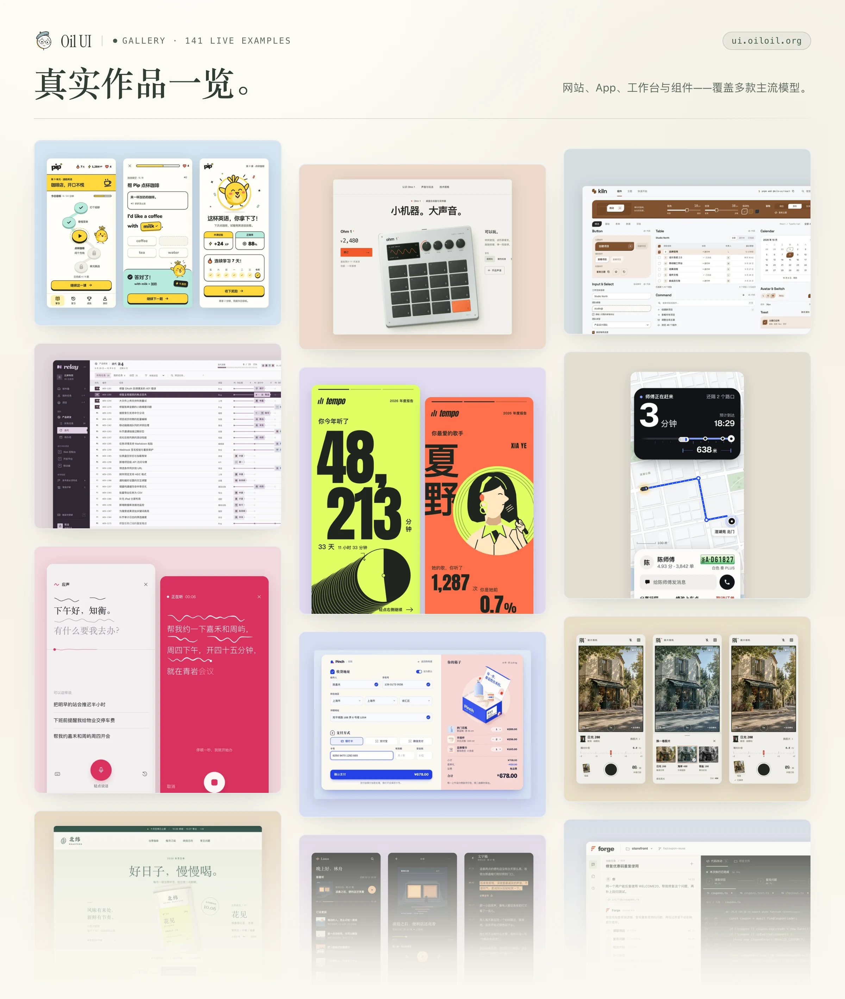
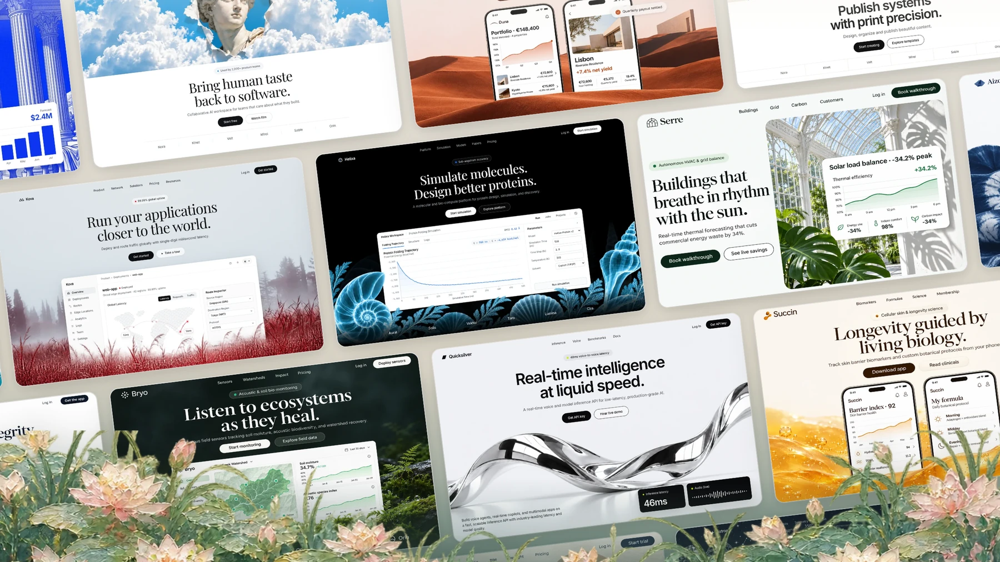

[English](README.md) · 中文 · [日本語](README.ja.md) · [한국어](https://ui.oiloil.org/ko/?utm_source=github&utm_medium=referral&utm_campaign=readme-zh&utm_content=lang-bar) · [Deutsch](https://ui.oiloil.org/de/?utm_source=github&utm_medium=referral&utm_campaign=readme-zh&utm_content=lang-bar) · [Español](https://ui.oiloil.org/es/?utm_source=github&utm_medium=referral&utm_campaign=readme-zh&utm_content=lang-bar)

[](https://github.com/oil-oil/oil-ui/stargazers) [](https://www.skills.sh/oil-oil/oil-ui/oil-ui) [](https://ui.oiloil.org/?utm_source=github&utm_medium=referral&utm_campaign=readme-zh&utm_content=hero-gallery) [](https://ui.oiloil.org/guide/ui-design-skills-tested/?utm_source=github&utm_medium=referral&utm_campaign=readme-zh&utm_content=guide-benchmark) [](LICENSE)

**Oil UI** 是给 AI 编程 Agent 用的界面与 UI/UX 设计 Skill：默认推荐一个明确的设计方向并对照真实浏览器截图打磨；需要比较时，可并排生成 3 套构图、字体与配色真正拉开差距的方案。网站、App、后台和组件都能做，141 件在线作品见 [ui.oiloil.org](https://ui.oiloil.org/?utm_source=github&utm_medium=referral&utm_campaign=readme-zh&utm_content=intro-text)。

```bash
npx skills add oil-oil/oil-ui
```

**兼容宿主：** Claude Code, Cursor, Codex, Windsurf, Cline, Antigravity, OpenCode, GitHub Copilot, Roo Code, DeepSeek Harness（[dsh-oil-ui](https://github.com/oil-oil/dsh-oil-ui)）, Kimi Code, Trae 及任意支持 `SKILL.md` 的 Agent。

<p align="center">
  
</p>

<p align="center">
  <a href="https://ui.oiloil.org/?utm_source=github&utm_medium=referral&utm_campaign=readme-zh&utm_content=showcase-banner"></a>
</p>

### 把官网做出艺术感（Oil UI Pro 免费附赠 `oil-art-landing`）

除了日常产品界面与后台工作台，**Oil UI Pro** 还免费附赠独立配套 Skill **`oil-art-landing`**：内置**涵盖桌面与移动 App 的丰富视觉锚点**（红外胶片、极地冰川、X 光暗房、温室龟背竹、暗岩苔藓、长虹玻璃、棉纸压凹、陶土沙丘、冰块兰花、靛蓝扎染等）与按业务派生语法，先并排挑方向再按你的产品适配出图，并还原成带前景遮挡层次与滚动动效的真实网页。[查看 20 套可交互实测案例 →](https://ui.oiloil.org/art-landing/?utm_source=github&utm_medium=referral&utm_campaign=readme-zh&utm_content=art-landing-banner)

<p align="center">
  <a href="https://ui.oiloil.org/art-landing/?utm_source=github&utm_medium=referral&utm_campaign=readme-zh&utm_content=art-landing-banner"></a>
</p>

## 安装

在终端直接运行：

```bash
npx skills add oil-oil/oil-ui
```

或者把这句话发给支持安装 Skill 的 Agent：

```text
请帮我安装这个 Skill：运行 npx skills add oil-oil/oil-ui
```

装好就能用，不需要额外配置。有新版本时，Agent 会在回复末尾提醒你，想更新直接让它更新就行。已经装了 Oil UI Pro 就不用再装开源版，两个同时装会抢着接同一类请求。

如果使用 DeepSeek Harness，可安装原生插件 [dsh-oil-ui](https://github.com/oil-oil/dsh-oil-ui)（`dsh plugin --profile web add github:oil-oil/dsh-oil-ui`，内置免费版，并会自动识别本机已装的 Oil UI Pro）。

## 使用

直接把任务告诉 Agent，例如：

- “用 oil-ui 给这个课程预约产品探索几种设计方向，做成可以预览的页面。”
- “做三种字体、配色和构图都不同的设计，放在对比页里让我选。”
- “帮我润色这个页面，按项目现有的设计规范来。”
- “只评审这个首页，告诉我哪里要改、怎么改，不要动文件。”
- “按这张截图还原页面，参考图里没有的手机布局也补上。”

有品牌资料、截图或现成的项目，可以一起交给它。没有参考也能开始，只有在不清楚要交付什么的时候，它才会问你。任务中的候选、截图和素材缓存默认放在项目里的 `.oil-ui` 工作区；正式代码和线上资产仍写回项目。

## 它怎么设计

1. **先看清这是什么产品。** 动手之前，先明确产品品类，找出同类里风格最鲜明的两三家，看它们怎么做、为什么这么做，再决定哪些沿用、哪些换掉。
2. **把“高级”“简洁”翻成具体的决定。** 先从题材、受众和品牌语气定下调性——热闹还是安静、精致还是粗粝、信息排得密还是疏——再落到字体、留白与色彩占比。
3. **每个方向都从具体的东西出发。** 可以是一种材质和它所在的环境、一个场景，也可以借用另一个领域的表现方式，不从“简约”“大气”这类空泛形容词出发。
4. **先想清楚首屏是给谁看的。** 来看内容、挑东西或干活的页面，首屏直接放内容和操作；需要说服别人的页面，才先定首屏版式再写文案。
5. **明确比较时，几个方向要真的不一样。** 版式、字体、配色和主视觉这四样里，任意两个方向最多只允许一样相同。小样并排眯眼看明暗分布，太像就重排构图，不靠换颜色凑数。
6. **留一处让人记住的地方。** 不把整页塞满装饰，只把一两处关键时刻做到位，比如点按反馈、付款完成、AI 运行状态或 404 页面，其余保持安静。
7. **好不好看由你来定。** 默认推荐一个方向给你确认；明确要求比较时才把几份小样放进同一个对比页，按你的取舍收紧后再往下做。
8. **以真实画面为准。** 做完在桌面和手机尺寸下打开页面看真实截图，可派没有制作上下文的独立评审把关，最后做一轮减法。

想改造存量老项目、合并整理 `DESIGN.md`、按需开启冲 9 分的深度打磨复核，或使用 19 套带源码卡片原型，可以了解 [Oil UI Pro](https://ui.oiloil.org/pro/?utm_source=github&utm_medium=referral&utm_campaign=readme-zh&utm_content=inline-pro)，区别见[下文](#开源版和-pro)。

## 实测横评与实战指南

- **[4 款 UI 设计 Skill 实测对比（15 次独立生成 + 在线 Demo）](https://ui.oiloil.org/guide/ui-design-skills-tested/?utm_source=github&utm_medium=referral&utm_campaign=readme-zh&utm_content=guide-benchmark)**：同模型同题测试 Oil UI、`frontend-design`、`UI UX Pro Max`、`Impeccable` 与无 Skill 对照，公开 15 次匿名视觉评分、功能验收细节与真机演示。
- **[已有项目 UI 改造与体验翻新指南](https://ui.oiloil.org/guide/existing-project-ui-renovation/?utm_source=github&utm_medium=referral&utm_campaign=readme-zh&utm_content=guide-renovation)**：在不改坏原有接口和校验逻辑的前提下，按「清噪音、调布局、省步骤」分三步翻新老项目，并提炼全站共用的 `DESIGN.md`。
- **[如何去掉 AI 界面的“塑料感”](https://ui.oiloil.org/guide/fix-ai-ui-slop/?utm_source=github&utm_medium=referral&utm_campaign=readme-zh&utm_content=guide-antislop)**：逐项拆解胶囊眉标、左侧粗彩条、三层套娃卡片与生造假指标，附可直接放进提示词的减法清单。
- **Agent 与场景实战**：[Claude Code 指南](https://ui.oiloil.org/guide/claude-code-ui-design/?utm_source=github&utm_medium=referral&utm_campaign=readme-zh&utm_content=guide-claude) · [OpenAI Codex 指南](https://ui.oiloil.org/guide/codex-ui-design/?utm_source=github&utm_medium=referral&utm_campaign=readme-zh&utm_content=guide-codex) · [官网与落地页实战](https://ui.oiloil.org/guide/landing-page-design/?utm_source=github&utm_medium=referral&utm_campaign=readme-zh&utm_content=guide-landing) · [后台与桌面工作台实战](https://ui.oiloil.org/guide/dashboard-workspace-design/?utm_source=github&utm_medium=referral&utm_campaign=readme-zh&utm_content=guide-dashboard) · [交互式方法与实样展厅](https://ui.oiloil.org/intro/?utm_source=github&utm_medium=referral&utm_campaign=readme-zh&utm_content=intro)

## 自带的风格对比页

<p align="center">
  
</p>

想比较几份设计时，它会把它们并排放进同一个页面。放进去的可以是 HTML 文件、图片，也可以是正在运行的开发页面，当前版本可放在第一个当对照。支持切换电脑和手机尺寸、点开看实际大小、用方向键翻看；看中哪一份点“选择”，把复制出来的一句话发给 Agent 就能接着推进。

## 开源版和 Pro

<p align="center">
  
</p>

开源版能把一个新页面从头做到好看。Pro 在这之上，帮你把界面做得好用、把老项目稳妥改好，并用更严格的评审和精修把质量往上推。

| | Oil UI 开源版 | Oil UI Pro |
| --- | :---: | :---: |
| 设计方向：认品类、定调性、拉开方向、风格对比页 | ✓ | ✓ |
| 视觉：层级、字体、配色、留白、配图和动效 | ✓ | ✓ |
| 让人记住的一刻和滚动叙事（视差、一镜到底） | ✓ | ✓ |
| 截图还原 | ✓ | ✓ |
| 小游戏的演出节奏、手感、生成素材和实时 3D | ✓ | ✓ |
| 独立评审 | 视觉打分与轻量 UX 走查 | 默认盲审 + 可选深度打磨（最多 3 轮冲 9 分与同路径 UX 复核）；检查几个方向有没有撞车；自主风险探针 |
| 精修：AI 默认审美自查、细节清单、怎么做减法 | | ✓ |
| 好用：交互和状态、表单、弹窗与浮层、电脑和手机上的布局 | | ✓ |
| 后台和工具：按产品挑工作区布局，让风格贯穿整页 | | ✓ |
| 老项目：优化 UI、改流程、加新功能各有一套做法 | 帮你分清是哪一种 | ✓ |
| 把原型实现为工程代码：对照表、用项目已有的组件和库实现、和原型并排核对 | 不整段搬运原型代码 | ✓ |
| 设计规范：新项目沉淀 DESIGN.md，多份规范打架时整理成一份 | 指出冲突的地方 | ✓ |
| 一页铺成一套：页面地图、各类页面的样板、跨页一致性检查、多个 Agent 分工 | | ✓ |
| 回改：把“不够高级”翻成具体改法，每轮附前后对比，不改坏已确认的部分，该重定方向时直说 | | ✓ |
| 把单个组件打磨到极致 | | ✓ |
| 19 套卡片原型和代码、空间折展容器 | | ✓ |
| 流光、点阵、流动渐变这类特效 | | ✓ |
| 小游戏的场景布局、视觉和状态检查 | | ✓ |
| 免费附赠 `oil-art-landing`：丰富的桌面与移动 App 艺术官网视觉锚点 + 按业务派生，支持前景遮挡落地 | | ✓ |

Oil UI Pro 99 元，一次买断，永久更新（送 100 生图积分并免费附赠 `oil-art-landing`），在 [ui.oiloil.org/pro](https://ui.oiloil.org/pro/?utm_source=github&utm_medium=referral&utm_campaign=readme-zh&utm_content=comparison-table-pro) 购买，或运行 `npx github:oil-oil/oil-cli install oil-ui-pro` 由 Agent 带你登录、付款并装好。

## 版本检查

每次使用时，Skill 最多每 10 分钟联网检查一次是否有新版本。它只读取 `ui.oiloil.org` 公开的版本列表，不上传项目内容；默认只提示，不下载、不替换任何文件，只有你明确要求更新时才更新。检查结果缓存在 `~/.local/state/oil/`（设置了 `XDG_STATE_HOME` 时用它，Windows 在 `%LOCALAPPDATA%\oil\`）。需要 Python 3；不想检查时设置环境变量 `OIL_NO_UPDATE_CHECK=1`。

## 搭配使用

- [oil-motion](https://github.com/oil-oil/oil-motion)：用生成的视频或序列帧做随滚动、拖动变化的网页动画，比如产品拆解、镜头穿越。
- [oil-tone](https://github.com/oil-oil/oil-tone)：把页面上的标题、说明和介绍改得自然、清楚、好读，中英文都能用。
- [Oil Book 相关文章](https://book.oiloil.org/articles/ai-ui-design?utm_source=github&utm_medium=referral&utm_campaign=oil-ui-readme-zh)：想看平时怎么挑高审美模型、做多方向对比和微调界面细节，可以参考《如何使用 AI 做出有高级感的设计》和[《如何从 0 到 1 Vibe Coding 一个个人网站》](https://book.oiloil.org/articles/vibe-coding-website-from-scratch?utm_source=github&utm_medium=referral&utm_campaign=oil-ui-readme-zh)。

## 许可

[MIT](LICENSE)
